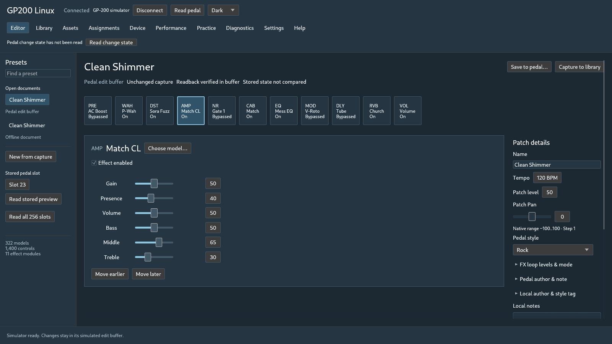
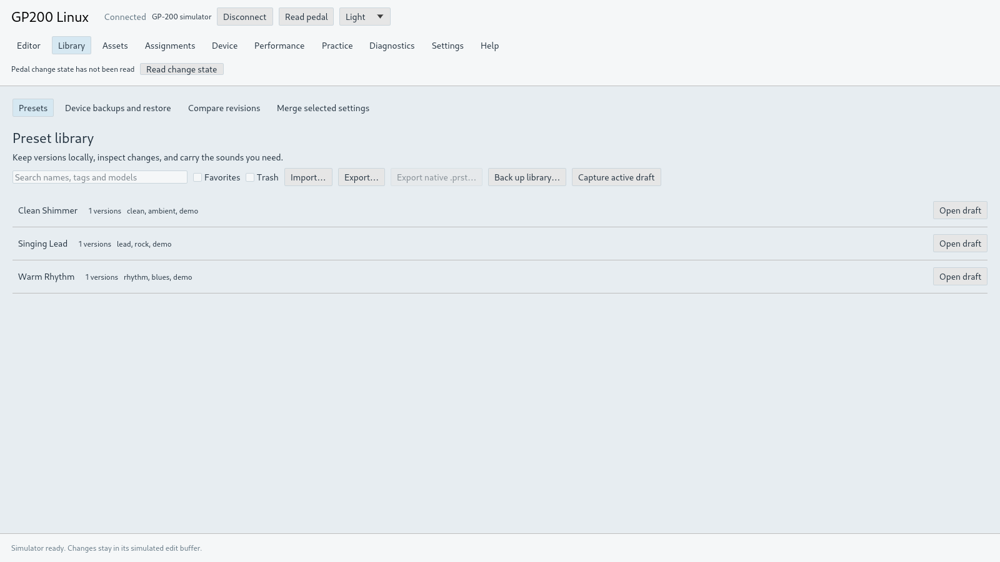

# GP200 Linux

An unofficial native Linux editor and librarian for the **Valeton GP-200**, built with Rust and egui. Edit sounds, organize a local preset library, prepare assets and connect to the pedal through USB MIDI.

GP200 Linux is an independent project. It is not affiliated with or endorsed by Valeton. The pedal performs the effects processing; this application manages its settings and files.

The project is under active development. It has useful tested workflows, but does not yet provide full compatibility with every feature of the official editor.

## Screenshots

Native captures using the labelled simulator and synthetic demo presets; no pedal is connected.

**Editor · dark theme**



**Preset library · light theme**



## Build and run

For an installable preview, use the [GitHub releases](https://github.com/geordyd/gp200-linux/releases). Packages target Linux **x86_64**, Ubuntu 24.04 or a compatible runtime with glibc 2.39 or newer. Choose the AppImage, make it executable and run it:

```sh
chmod +x GP200-Linux-0.1.1-x86_64.AppImage
./GP200-Linux-0.1.1-x86_64.AppImage
```

If FUSE is unavailable, run it with `--appimage-extract-and-run`. The portable `.tar.gz` is an alternative: extract it and run `python3 install-user.py` from its folder. Checksums accompany both downloads. See [release instructions](docs/releasing.md) for runtime requirements and package validation.

Build on Linux with Rustup, which uses the pinned toolchain in [`rust-toolchain.toml`](rust-toolchain.toml). You also need a C compiler, a C++20 compiler, `pkg-config`, ALSA development headers and D-Bus development headers. The GUI needs a Wayland or X11 desktop and OpenGL/Mesa. Native file dialogs use `xdg-desktop-portal` with a backend for your desktop.

```sh
git clone https://github.com/geordyd/gp200-linux.git
cd gp200-linux
cargo build --locked --release -p gp200-gui -p gp200-cli
./target/release/gp200-gui
```

The application opens an offline workspace. To use a pedal, connect a GP-200 in **normal USB mode**, close competing editors and choose **Connect**. Connection is explicit; launching the application alone does not open a MIDI session.

```sh
# Labelled simulator; no pedal required.
cargo run --locked -p gp200-gui -- --demo --theme dark

# Available commands for the headless CLI.
cargo run --locked -p gp200-cli -- --help
```

The interface is English, with persistent dark, light and system themes and adjustable display scale. See the [user guide](docs/user-guide.md) for editing, connection and backup basics.

Release automation builds Linux x86_64 AppImage and portable `.tar.gz` packages, checks them using the native simulator, and prepares a draft prerelease for review.

## What is available

- A catalog-based editor with lossless preset drafts, Undo/Redo, A/B comparison, preset diffs and selected settings merge. Local crash recovery restores offline drafts without replaying device operations.
- A revisioned local library with search, tags, favorites and setlists; native `.prst` import/export; application bundles and durable device-bank archives.
- USB-MIDI reads of the current buffer, stored presets, globals and supported asset metadata. Validated live workflows cover parameter and bypass edits, selected model changes and sampled preset save/copy operations.
- Expression, CTRL, quick-access and FX-loop routing pages, plus global settings and drum-pattern controls. Stored settings have scoped hardware tests; physical controller actions and audio routing need broader verification.
- Local WAV/IR preparation and offline NAM rendering for supported model profiles. Independent NAM-to-CLO calibration is experimental; useful tonal quality and pedal upload are not verified.
- A headless CLI for local inspection, conversion, library/archive operations, bounded support exports and explicit read-only device queries.

## Device and firmware status

Hardware work has been performed on a **GP-200**. The tested firmware path is **V1.6.3 → V1.8.2**: after interrupted attempts, a Linux full-image recovery completed all **35,851 blocks**, returned the pedal to normal mode and obtained fresh identity/current/settings reads. The owner also confirmed **V1.8.2** on the pedal display.

That result establishes this recovery on this pedal. It does not establish every firmware version, GP-200LT/GP-200JR support, or preservation of all presets, settings and installed sounds. Broader editing and controller tests must be repeated on V1.8.2.

The Linux updater is included in ordinary builds, with its support materials embedded in the application. It requires explicit, separate connection/query/transfer reviews and the supported official V1.8.2 firmware file; firmware images are not distributed by this project. See the [firmware workflow](docs/firmware.md). Firmware completion does not verify a complete data restore.

Device-bank archives currently retain presets, the current buffer, globals and supported metadata. **IR audio and SnapTone contents are missing**, so these archives are not complete restorable sound backups. Physical IR/SnapTone upload, rename, deletion and recovery are not accepted features. Native file round trips are supported locally; complete interoperability with all official-editor export modes remains open.

## Roadmap

- Improve layouts, scaling and everyday editing interactions.
- Expand effect/default coverage and test expression, CTRL, footswitch and routing behavior on V1.8.2.
- Verify IR/SnapTone content transfers and complete backup/restore workflows.
- Improve experimental NAM-to-CLO calibration and verify tonal quality independently.
- Validate the full range of original preset files and embedded assets.
- Broaden Linux distribution, accessibility and firmware-version coverage.

See [CONTRIBUTING.md](CONTRIBUTING.md) to help and [SECURITY.md](SECURITY.md) to report a security concern. Changes are recorded in [CHANGELOG.md](CHANGELOG.md).

## License

Project-authored code is licensed under the [MIT License](LICENSE). Third-party code, fonts and dependencies retain their own licenses and notices. Functional catalog metadata has separate provenance documented in [`assets/catalog/README.md`](assets/catalog/README.md). Valeton product names identify the supported hardware and do not imply endorsement.
